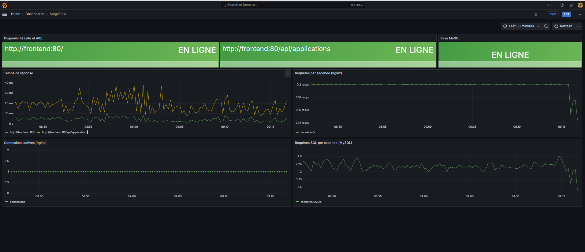
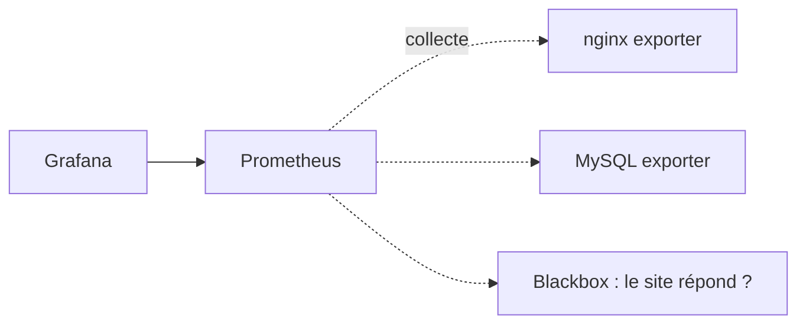

# stageflow-deploy

Pipeline **DevOps** pour [StageFlow](https://github.com/khadidja-ahmat/StageFlow), mon application de suivi de candidatures de stage
(Java 21, Spring Boot, React, MySQL).

Ce dépôt ne contient **pas** le code de l'application. Il contient tout ce qui permet de la **construire, la lancer, la tester, la surveiller,
la sauvegarder et la livrer** automatiquement. Le code de StageFlow est récupéré depuis son propre dépôt.

[](https://github.com/khadidja-ahmat/stageflow-deploy/actions/workflows/ci.yml)

## Ce que fait ce dépôt

- **Docker** : l'application tourne avec 3 conteneurs : le site (React + nginx), l'API (Spring Boot) et la base (MySQL).
- **CI/CD (GitHub Actions)** : à chaque push, l'application est construite, démarrée et testée, puis les images sont publiées.
- **Supervision (Prometheus + Grafana)** : un tableau de bord montre si le site, l'API et la base fonctionnent.
- **Sauvegardes** : la base MySQL est sauvegardée automatiquement, et un test vérifie que la restauration marche.

## Lancer en local

Prérequis : Docker et Git.

```bash
git clone https://github.com/khadidja-ahmat/stageflow-deploy.git
cd stageflow-deploy
git clone https://github.com/khadidja-ahmat/StageFlow.git stageflow   # le code de l'application
docker compose up --build
```

L'application est disponible sur <http://localhost:8080>.

```bash
./scripts/smoke-test.sh   # vérifie que tout fonctionne
./scripts/seed.sh         # ajoute 5 candidatures fictives
```

Arrêt : `docker compose down` (ajouter `-v` pour supprimer aussi les données).
Le mot de passe MySQL est une valeur de démonstration locale ; il peut être changé avec un fichier `.env` (modèle : `.env.example`).

## Supervision (Prometheus + Grafana)



La supervision est **optionnelle** : on l'ajoute avec un profil Docker Compose.

```bash
docker compose --profile supervision up --build -d
```

- Grafana : <http://localhost:3000> (identifiants `admin` / `admin`), puis **Dashboards → StageFlow**
- Prometheus : <http://localhost:9090>

Le tableau de bord montre :

- si le site, l'API et la base sont en ligne ;
- le temps de réponse ;
- les requêtes par seconde et les connexions (nginx) ;
- les requêtes SQL par seconde (MySQL).

Comment ça marche :



- **Prometheus** interroge régulièrement chaque service et garde les chiffres.
- Un **exporter** traduit un outil (nginx, MySQL) dans un format que Prometheus comprend.
- **Blackbox** joue le rôle d'un visiteur : il vérifie que le site et l'API répondent.
- **Grafana** transforme les chiffres en graphiques.

## Sauvegardes

Le profil `sauvegarde` sauvegarde la base MySQL au démarrage, puis une fois par jour. Les fichiers (`.sql.gz`) sont dans le dossier `backups/`
(non versionné) ; ceux de plus de 7 jours sont supprimés.

```bash
docker compose --profile sauvegarde up -d
```

**Sauvegarder tout de suite :**

```bash
docker compose --profile sauvegarde run --rm --no-deps --entrypoint sh backup /scripts/backup.sh
```

**Restaurer** (remplacer le nom par un fichier de `backups/`) :

```bash
docker compose --profile sauvegarde run --rm --no-deps --entrypoint sh backup /scripts/restore.sh /backups/stageflow_20261116_090000.sql.gz
```

`scripts/test-backup-restore.sh` vérifie que la sauvegarde sert : il crée une candidature, sauvegarde, la supprime, restaure, puis contrôle
qu'elle est revenue. Ce test tourne aussi dans la CI.

## Le pipeline GitHub Actions

À chaque `git push` :

1. construction des images Docker et démarrage de l'application ;
2. test de bout en bout (créer, lire, supprimer une candidature) ;
3. test de la sauvegarde et de la restauration ;
4. vérification des fichiers de configuration (Compose, Prometheus, scripts, tableau de bord) ;
5. publication des images sur GitHub Container Registry (branche `main` uniquement) :
   `ghcr.io/khadidja-ahmat/stageflow-deploy/backend` et `.../frontend`.

## Choix et limites

- **Aucune donnée réelle** : la démo utilise uniquement des candidatures fictives.
- StageFlow n'a pas d'authentification : cette configuration est prévue pour un usage local ou de démonstration, pas pour un hébergement public.
- La supervision mesure le trafic et la disponibilité ; elle ne modifie pas le code de StageFlow.
- Pas de déploiement sur un serveur pour l'instant : la livraison s'arrête à la publication des images.

## Auteur

Khadidja Ahmat Hassan
